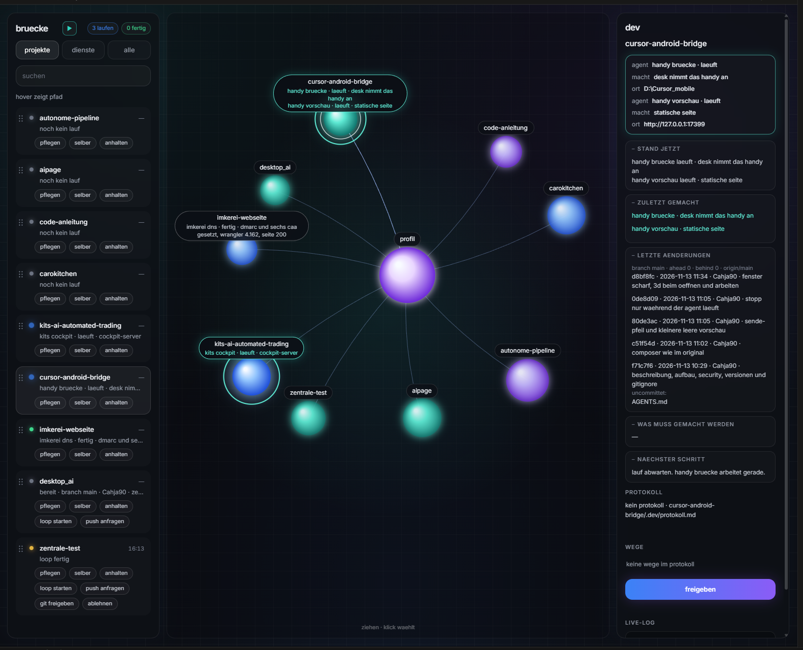
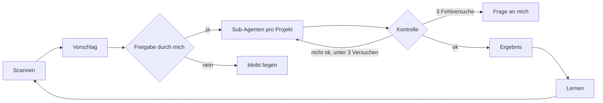

# Desktop_AI

**Die lokale Zentrale für alle meine Projekte.** Hier laufen Projekte, Agenten und Loops zusammen: Die KI scannt die Projekte, findet Fehler und Verbesserungen, schlägt sie vor und arbeitet sie nach meiner Freigabe mit Sub-Agenten ab. Das meiste läuft autonom, aber immer unter Kontrolle. Am Ende bekomme ich nur das geprüfte Ergebnis.



## So funktioniert es

Jedes Projekt hat einen eigenen Agenten mit eigenem, engem Fenster, der nur in seinem Projektordner (seiner „Lane“) arbeitet. Dadurch kann man direkt in den einzelnen Projekten arbeiten, während die Zentrale alle Projekte gleichzeitig im Blick behält. So kann man jederzeit ein einzelnes Projekt herauspicken und gezielt bearbeiten.

## Der Ablauf



1. **Scannen** – Die Zentrale geht die eingetragenen Projekte durch (`pflege <projekt>` oder `pflege alles`). Agenten im Modus `vorschlagen` lesen nur und schreiben einen Bericht. `pipeline/pruefen.py` sammelt dabei Punkte wie fehlende README, Beschreibung, Topics oder Demo.
2. **Vorschlag** – Aus den Funden entsteht ein Plan mit Fehlern und Verbesserungen. Er wird mir vorgeschlagen, in der Zentrale oder per Handy.
3. **Freigabe** – Ich nehme den Plan an, ändere ihn oder lehne ab. Ohne mein Ja passiert nichts.
4. **Sub-Agenten** – Pro Projekt startet ein eigener Agent in genau dieser Lane, entweder headless über die Cursor-CLI oder als sichtbares Cursor-Fenster (über [grok-cursor-bruecke](https://github.com/Cahja90/grok-cursor-bruecke)). Gearbeitet wird auf einem lokalen Arbeits-Branch.
5. **Kontrolle** – Jede Aufgabe wird geprüft: Tests, Bug-Check, Security-Check und gitleaks. Bleibt der Agent außerhalb seiner Lane? Sind die Fertig-Regeln erfüllt? Wenn nicht, bekommt er einen Korrektur-Auftrag.
6. **Ergebnis** – Erst wenn alles grün ist, gibt es einen lokalen Commit mit Agent-Kennung und einen Eintrag im Protokoll. Ich bekomme nur das fertige Endergebnis zu sehen.
7. **Lernen** – Was schiefging, steht im Protokoll. Antworten auf offene Fragen und neue Regeln landen in `AGENTS.md` bzw. `regeln/` und gelten beim nächsten Lauf. So wird der Ablauf mit jeder Runde besser.

## Autonomie und Kontrolle

Zu Beginn eines Loops wähle ich den Modus: **schrittweise** (ich bestätige jeden Schritt) oder **autonom** (die KI arbeitet den freigegebenen Plan allein ab).

Was die KI allein darf:

- in der Lane des Projekts lesen, ändern und testen
- einen lokalen Arbeits-Branch anlegen
- nach jeder fertigen Aufgabe automatisch **lokal** committen (Autor `agent-cli` bzw. `agent-fenster`)
- bis zu 3 Korrekturen pro Aufgabe selbst versuchen

Was immer mein Ja braucht:

- alles Öffentliche: Push, Pull-Request, Merge, Tags, Releases, Deploy, DNS
- Änderungen oder Löschen außerhalb der Lane
- Force-Push, History umschreiben, Repos löschen

Weitere Regeln:

- **Nach 3 fehlgeschlagenen Korrekturen** stoppt der Agent und fragt mich, mit mehreren Antwortmöglichkeiten.
- **Fragen werden gesammelt** (`.loop/fragen.md` pro Projekt) und in der Zentrale angezeigt, statt den Lauf ständig zu unterbrechen.
- **Benachrichtigung aufs Handy** nur bei Meilensteinen und Problemen, nicht bei jedem Schritt. Lokal gibt es zusätzlich Windows-Hinweise (`dev/toast.ps1`).
- **Limits** gegen Ausufern: maximal gleichzeitige Läufe, Läufe pro Tag und Timeout stehen in `dev/einstellungen.json`.
- **Anhalten** nur gezielt per Prozess-ID, nie pauschal alle Prozesse.

## Überblick in der Zentrale

Die Weboberfläche (`maske/`) läuft nur lokal unter `http://127.0.0.1:17341`:

- links die eingetragenen Projekte und Dienste (Tabs, Gruppen, per Ziehen sortierbar)
- rechts die Konsole mit Stand, letzten Änderungen, offenen Aufgaben und nächstem Schritt
- pro Projekt: Branch, uncommittete Dateien, letzte Commits mit Autor/Agent, laufende Agenten, offene Fragen und Freigaben
- Freigaben für Push oder PR werden direkt dort bestätigt (oder per Handy-Chat)

Alles wird protokolliert: Git ist das Hauptprotokoll, dazu ein zentrales Protokoll über alle Projekte und pro Projekt `.dev/protokoll.md`.

## Sicherheit

- Der Server lauscht nur auf `127.0.0.1`, nicht im Netz.
- Geheimnisse werden nie eingelesen, in der Oberfläche maskiert und nicht protokolliert.
- Vor jedem Push läuft gitleaks (`dev/gitleaks-pruefen.ps1`).
- Ordner, die keine Lane sein dürfen, stehen in `regeln/grenzen.yaml`. Persönliche Daten liegen nur in lokalen `*.lokal.*`-Dateien, die nicht im Repo landen.
- Agent-Commits nutzen keine echten E-Mail-Adressen.

## Aufbau

| Ordner / Datei | Inhalt |
| --- | --- |
| `bruecke/` | lokaler Server (`server.py`), Zentrale mit Register, Agentenstart, Git-Freigabe und Protokoll (`zentrale.py`), Start (`oeffnen.py`) |
| `maske/` | Weboberfläche der Zentrale |
| `dev/` | Dev-Orchestrator: Warteschlange (`warteschlange.py`), Agentenstart (`starte.ps1`), Routine, Einstellungen, gitleaks, Vorlage für `AGENTS.md` |
| `pipeline/` | Prüfung der Projekte (`pruefen.py`) und Freigabe-Logik (`schiffen.py`), mit Tests |
| `projekte/` | Register der Projekte in der Zentrale (`register.json`) und Projektliste |
| `regeln/` | Grenzen, Profil, Pins, Topics |
| `auftraege/` | Pläne und Aufträge, z. B. `PLAN-ZENTRALE.md` |
| `AGENTS.md`, `plan.md` | Rolle der KI und Gesamtplan |

## Start

```powershell
python bruecke\oeffnen.py
```

Danach öffnet sich die Zentrale unter `http://127.0.0.1:17341`. Optional läuft die Warteschlange dauerhaft mit `python dev\warteschlange.py loop`. Details stehen in `dev/LIESMICH.md`.

## Lizenz

MIT, siehe [LICENSE](LICENSE).
