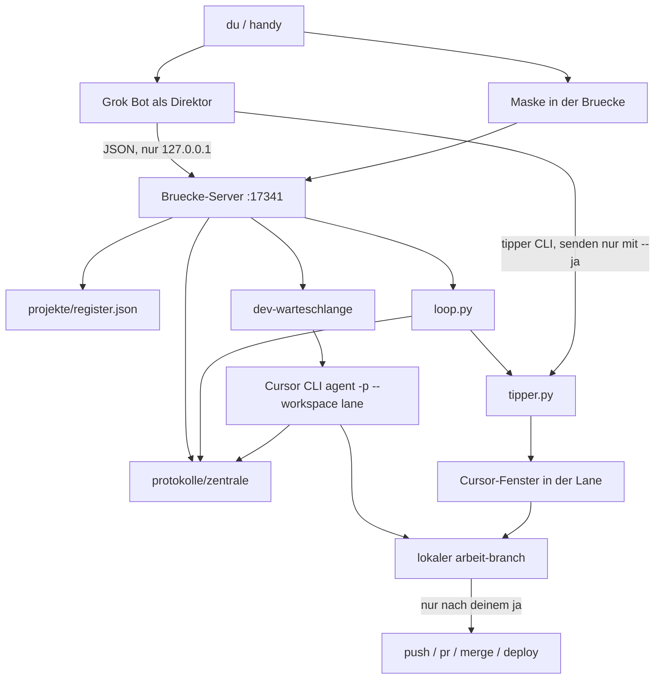
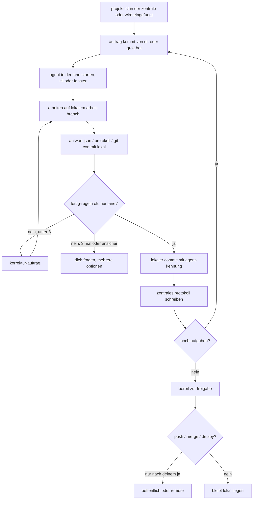

# plan: zentrale in der bruecke

stand: 14. november 2026. nur plan, noch kein bau. nichts committen, nichts pushen.

ziel in deinen worten: du willst nicht jedes mal alle projekte neu oeffnen. in der bruecke suchst du aus, welche projekte reinommen. von dort startest du pro projektordner eigene agenten, wenn etwas geaendert werden soll. alles wird protokolliert, vor allem ueber git, damit klar ist wer was wo gemacht hat. volle uebersicht, volle kontrolle was in git reinkommt. das volle programm, alles zusammen.

grok bot (handy) ist der direktor. cursor-fenster und der cursor-cli-agent (`agent -p --force --trust --workspace <ordner>`) sind die worker. nur eigener code, keine fremden agent-frameworks.

gebaut wird erst, wenn du diesen plan freigibst und die offenen fragen am ende beantwortet hast.


## was schon da ist

zwei teile, die wir nicht neu erfinden, sondern zusammenziehen.

**desktop_ai (die bruecke / maske)**

- start: `python bruecke\oeffnen.py` → maske unter `http://127.0.0.1:17341`
- links die projekte und dienste (tabs, ziehen, gruppen), rechts die konsole (`/dev/bericht`: stand, letzte aenderungen, todos, naechster schritt)
- dienste oeffnen im eigenen fenster, aber nur per doppelklick
- projektliste heute: `projekte/liste.yaml` (nur namen, saas, demo). der ordner wird fest als `hub\<name>` angenommen. externe pfade gehen noch nicht.
- `maske/anordnung.json` merkt sich reihenfolge und gruppe, nicht die projektliste selbst
- `auswahl.yaml` ist etwas anderes: auf/zu fuer die alte pipeline, nicht die zentrale
- dev-orchestrator: `POST /dev/auftrag`, `POST /dev/anhalten`, queue in `dev/queue.json`, stand in `dev/status.json`
- agentenstart schon da: `dev\starte.ps1` startet den cli-agenten im projektordner. modi heute: `vorschlagen` (nur lesen) und `selber` (branch, aendern, lokal commit, **danach branch pushen und pr, kein merge**)
- git in der konsole schon teilweise: letzte commits, uncommittete dateien, ahead/behind. autor und klarer branch-name fehlen noch
- protokolle liegen unter `protokolle\` und in jedem projekt unter `.dev\protokoll.md`
- server nur auf 127.0.0.1, geheimnisse werden maskiert, logs bleiben in der lane
- desktop_ai selbst ist **kein git-repo**. die kind-ordner darunter schon, soweit sie repos sind

**grok-cursor-bruecke** (`<projekt>/grok-cursor-bruecke`)

- `tipper.py` sieht cursor-fenster, tippt, liest, macht screenshots (`bild`), wartet, stoppt. `senden` nur mit `--ja` nach deinem ok im chat
- `PLAN.md` beschreibt den director/worker-loop: `.loop/` pro projekt, json-auftrag und json-antwort, lane, modus schrittweise oder autonom, 3 korrekturen, lokaler auto-commit, handy nur bei meilensteinen und problemen
- `loop.py` ist **noch nicht gebaut**. der plan steht, der code fehlt
- `cursor -n <ordner>` (neues fenster oeffnen) ist noch ungetestet


## zielbild

die bruecke wird die zentrale. einmal projekte einfügen, danach bleiben sie in der liste, bis du sie wieder rausnimmst. du musst sie nicht jedes mal neu oeffnen.

pro eingetragenem projekt:

- eine feste lane (genau dieser ordner)
- eigener agent, wenn du oder grok bot sagst, dass etwas geaendert werden soll: entweder headless per cli oder als cursor-fenster ueber tipper
- eigener `.loop/`-ordner, sobald ein loop laeuft
- eigene git-arbeit auf einem lokalen arbeit-branch
- sichtbarer stand in der maske: branch, uncommittete aenderungen, letzte commits mit autor/agent, laufende agenten, offene aufgaben, offene fragen

ueber alle projekte hinweg:

- ein zentrales protokoll (wer, wann, welches projekt, welcher auftrag, welcher commit)
- merge, push, pr, deploy und alles oeffentliche nur nach deinem ja, in der maske oder vom handy
- grok bot steuert das ueber die lokale http-api der bruecke plus tipper, beides json und knapp


## uebersicht



ablauf einer aenderung:




## 1. projekt-register

das ist die liste der projekte, die in der zentralen drin sind. du suchst aus, was reinommt. nichts landet von allein dort.

**wo gespeichert:** neue datei `hub\projekte\register.json`. `liste.yaml` bleibt fuer die alte portfolio-liste (saas, demo, github-konto) und wird nicht umgebaut. die maske liest fuer die zentrale das register, nicht die yaml.

jeder eintrag mindestens:

```json
{
  "id": "bruecke-hub",
  "name": "desktop_ai",
  "pfad": "hub",
  "aktiv": true,
  "art": "hub",
  "eingefuegt": "2026-11-14T16:00:00",
  "lane_ausschluss": ["beispiel-pipeline", "beispiel-seite", "beispiel-anleitung", "beispiel-saas", "beispiel-agent", "beispiel-bridge", "beispiel-web"]
}
```

- `id`: kurzer sicherer name (buchstaben, zahlen, bindestrich, unterstrich), kein pfad
- `pfad`: der echte projektordner, auch ausserhalb von desktop_ai, wenn du das so willst (offene frage unten)
- `aktiv`: in der uebersicht sichtbar. rausnehmen setzt das auf false oder loescht den eintrag, **den ordner selbst fasst das nie an**
- `lane_ausschluss`: optional, vor allem beim hub, damit ein agent in desktop_ai nicht in die geschwister-projekte schreibt

hinzufuegen und entfernen:

- in der maske: knopf oder dialog "projekt einfuegen" (ordner waehlen, id und anzeigename vorschlagen, du bestaetigst)
- per api, damit grok bot es vom handy anstossen kann, aber nur wenn du den ordner genannt hast
- entfernen = aus dem register und aus der anordnung, kein loeschen auf der platte, keine git-befehle

beim einfuegen pruefen: pfad existiert, ist ein ordner, liegt nicht in den verbotenen bereichen (`<privat>` secrets, `<privat>`, `.env`, `profil\kontakt.txt`), id ist eindeutig, und der pfad wird kanonisch gespeichert (keine `..`).


## 2. uebersicht in der maske

die vorhandene maske bleibt. links die liste der **eingefuegten** projekte, rechts die konsole, dienste wie bisher.

pro projektkarte und in der konsole neu bzw. erweitert:

- git-branch (aktueller und der arbeit-branch, falls anders)
- uncommittete aenderungen (dateinamen, geheimnisse weiterhin ausblenden)
- letzte commits: hash, zeit, betreff, **autor** und falls vorhanden agent/auftrag aus dem trailer
- ob der arbeit-branch dem remote voraus ist (ahead), ohne still zu fetchen
- laufende agenten: cli (pid, start, auftrag) und/oder cursor-fenster (titel, tipper-nummer)
- offene aufgaben aus `.loop/plan.json` bzw. der queue
- offene fragen aus `.loop/fragen.md` oder der zentralen fragenliste

datenquelle: neuer endpunkt `GET /zentrale/stand?projekt=<id>` (oder die liste fuer alle). `/dev/bericht` bleibt, wird aber um autor, branch und agenten ergaenzt, sobald das projekt im register steht.

kein dauer-refresh gegen git, der den pc belastet. wie bisher kurz cachen (ein paar sekunden). am anfang eines tests schauen wir oefter nach, alle paar minuten, ob der stand stimmt.


## 3. agenten pro projekt

eine lane pro projekt: der eingetragene pfad. der agent darf nur darin schreiben. ausserhalb, oder in `lane_ausschluss`, ist tabu und fuehrt zum stopp plus frage an dich.

zwei startarten, die du bzw. grok bot waehlen:

1. **cli, headless** — wie `dev\starte.ps1` schon kann: `agent -p --force --trust --workspace <lane>`. gut fuer klare, abgegrenzte auftraege und fuer den loop, wenn kein fenster noetig ist. log unter `<lane>\.dev\laeufe\`.
2. **cursor-fenster** — `cursor -n <lane>` (erst testen), dann tipper: `vorbereiten`, nach regel `senden --ja`, `warten`, `lesen`, `bild`. gut wenn man zuschauen will oder der loop groessere arbeit macht.

im test erst **genau ein agent pro projekt** (entweder cli oder fenster). spaeter kann grok bot je projekt mehr fenster nehmen, wie in `PLAN.md` schon vorgesehen. ueber alle projekte bleibt ein limit wie in `dev/einstellungen.json` (`max_gleichzeitig`, heute 2), damit nichts ausufert.

anhalten nur per pid (cli) bzw. tipper `stopp` (fenster). nie alle python- oder node-prozesse killen.

wenn du sagst, in projekt x soll etwas geaendert werden, ist der weg:

1. projekt steht im register, sonst erst einfuegen
2. auftrag als json (siehe loop-format aus `PLAN.md`)
3. agent in genau dieser lane starten
4. ergebnis landet in antwort, protokoll und lokalem commit


## 4. wer hat was gemacht: git und zentrales protokoll

git ist das hauptprotokoll. zusaetzlich gibt es eine lesbare liste ueber alle projekte.

**commits der agenten** nur lokal, und nur auf einem arbeit-branch, z.b. `arbeit/<auftrag-id>`. dein globaler git-name wird nicht umgeschrieben. der einzelne commit bekommt eine kennung, vorschlag:

- autor nur fuer diesen commit, z.b. `agent-cli` bzw. `agent-fenster`, mail `agent@local` (keine echte adresse, nichts oeffentliches)
- trailer am ende der message:

```text
Agent: cli
Auftrag: t1
Projekt: desktop_ai
```

so sieht man im log sofort, ob du oder ein agent committed hat. im zweifel steht die entscheidung dazu unten.

nach jeder fertigen aufgabe: automatischer **lokaler** commit, wie in `PLAN.md`. kein push.

**zentrales protokoll** unter `hub\protokolle\zentrale/`:

- `zentrale.jsonl` — eine zeile pro ereignis, maschinenlesbar
- `zentrale.md` — dieselbe geschichte kurz lesbar

felder pro zeile: zeit, projekt-id, agent (cli/fenster/grok), auftrag-id, art (`start`, `stopp`, `commit`, `frage`, `freigabe`, `ablehnung`, `fehler`), commit-hash, kurztext. keine secrets, keine inhalte von `.env` oder kontakt-dateien. diese dateien bleiben lokal im hub, sie werden nicht in fremde oder oeffentliche repos kopiert.

pro projekt bleibt zusaetzlich `.loop/log.md` und `.dev/protokoll.md`.


## 5. git-kontrolle

das ist die stelle, an der du die volle kontrolle behältst.

agenten duerfen:

- arbeit-branch anlegen, wenn er fehlt
- in der lane aendern
- lokal committen, mit kennung
- tests und gitleaks lokal laufen lassen

agenten duerfen **nicht** ohne dein ja:

- `git push` (auch nicht den arbeit-branch)
- pull-request oeffnen
- mergen
- tags, releases
- deploy, dns, irgendwas oeffentliches
- force-push, history umschreiben, repos loeschen
- ausserhalb der lane loeschen oder aendern

**wichtig:** der heutige modus `selber` in `starte.ps1` pusht den branch und oeffnet einen pr. fuer die zentrale gilt das so nicht mehr. vorschlag (frage unten): von der zentrale aus nur noch lokal arbeiten; push und pr werden eigene schritte nach freigabe.

freigabe laeuft so:

1. in der maske siehst du: branch, diff-zusammenfassung, commits, ob gitleaks schon gelaufen ist
2. du sagst ja in der maske **oder** im handy-chat an grok bot
3. erst dann fuehrt der server den einen freigegebenen schritt aus (push oder pr oder merge), schreibt das protokoll, und hoert auf
4. ohne ja bleibt alles lokal liegen

gitleaks vor jedem freigegebenen push, wie in den bestehenden regeln. secrets nie einlesen, nur scannen.


## 6. wie grok bot damit redet

zwei lokale wege, beide nur auf deinem pc:

1. **http-api der bruecke** auf `http://127.0.0.1:17341`, nur localhost, gleiche host/origin-pruefung wie heute. json rein, json raus. grok bot ruft das ueber die shell auf deinem rechner auf, nicht aus dem internet.
2. **tipper-cli** in `<projekt>/grok-cursor-bruecke`, wenn ein cursor-fenster bedient werden soll. `senden` weiter nur mit `--ja`, und `--ja` nur wenn du im chat ja gesagt hast — ausser du hast fuer einen konkreten loop den autonomen modus einmal freigegeben. dann darf der loop in der lane selbst senden, wie in `PLAN.md`. ausserhalb der lane, push und deploy bleiben tabu.

neue bzw. gebündelte endpunkte (namen koennen noch knapp gehalten werden):

- `GET /zentrale/projekte` — register plus kurzstand
- `POST /zentrale/projekte` — einfuegen (`id`, `name`, `pfad`), nur nach deiner auswahl
- `POST /zentrale/projekte/raus` — aus der liste nehmen, ordner bleibt
- `GET /zentrale/stand?projekt=` — git, agenten, aufgaben, fragen
- `POST /zentrale/agent/start` — `{projekt, art: "cli"|"fenster", auftrag, modus}`
- `POST /zentrale/agent/stopp` — nur pid bzw. tipper-stopp
- `POST /zentrale/loop/start` und `.../stopp`, `GET /zentrale/loop/stand`
- `GET /zentrale/protokoll`
- `GET /zentrale/fragen`, `POST /zentrale/fragen/antwort`
- `POST /zentrale/git/freigabe` — `{projekt, aktion: "push"|"pr"|"merge", ja: true}` ohne `ja` passiert nichts

bestehende `/dev/*`-endpunkte bleiben, damit die jetzige maske nicht bricht. neue sachen haengen wir an `/zentrale/`.


## 7. loop aus PLAN.md

`PLAN.md` in der bruecke bleibt die vorgabe fuer den ablauf in **einem** projekt. die zentrale startet und beaufsichtigt diese loops, sie ersetzt sie nicht.

kurz der vertrag, unveraendert:

- grok bot entwirft den plan, du gibst ihn frei
- `.loop/plan.json`, `auftrag/<id>.json`, `antwort/<id>.json`, `log.md`, `fragen.md` liegen in der lane
- start fragt: schrittweise oder autonom
- autonom: fertig nach festen regeln (tests gruen, startet, diff nur in der lane), fragen werden gesammelt
- max 3 korrekturen, dann dich fragen, mit mehreren antworten zur auswahl
- lokaler commit nach jeder fertigen aufgabe
- haenger: `warten` merkt es, stopp, nochmal senden, nach 3 mal dich fragen
- handy: nur meilenstein oder problem

was die zentrale dazu beiträgt: welches projekt (lane) gemeint ist, welcher agent-typ, das zentrale protokoll, die freigabe wenn etwas aus der lane raus oder oeffentlich soll, und die uebersicht ueber mehrere projekte gleichzeitig.

`loop.py` wird in `<projekt>/grok-cursor-bruecke` gebaut, nicht als fremdes framework. die zentrale ruft es nur auf.


## 8. sicherheit

gilt weiter, auch im autonomen modus:

- lane ist der eingetragene projektordner. ausserhalb nachfragen, nicht still machen
- nie lesen oder ausgeben: `<privat>` secrets (`.desk_token`, `.tunnel_token`, `.certs`, `chats.json`), `<privat>\.env`, alle `.env`, `profil\kontakt.txt`
- keine privaten mailadressen oder internen projektnamen nennen oder drucken
- prozesse nur per pid beenden, nie "alle python/node"
- kein push, kein deploy, nichts oeffentliches ohne dein ja
- tipper-regel: `senden --ja` nur nach freigabe (pro schritt oder einmalig fuer den loop)
- server bleibt 127.0.0.1, keine fremde seite darf auftraege einreihen
- screenshots und logs koennen interne pfade enthalten: nicht in oeffentliche repos
- `.loop/`, laeufe-logs und das zentrale protokoll bleiben lokal
- gitleaks vor freigegebenem push
- sensible projekte (geld, handel): in der zentralen nur anfassen, wenn du das projekt absichtlich einfuegst, und dann trotzdem kein `.env` lesen, kein handel von hier


## 9. meldungen aufs handy

nur meilensteine und probleme. nicht jeder kleine schritt.

meilenstein: aufgabe fertig, plan leer, etwas wartet auf deine freigabe (push/merge).
problem: haenger, 3 korrekturen verbraucht, lane-verstoss, agent abgestuerzt, frage die dich braucht.

am anfang eines tests schaut grok bot trotzdem alle paar minuten in stand und logs, sagt aber nur etwas, wenn etwas haengt oder ein meilenstein da ist.


## 10. bauschritte, in dieser reihenfolge

nichts davon wird angefangen, bevor der plan frei ist.

1. `cursor -n <ordner>` einmal testen (fenster auf, richtiges projekt, in `tipper.py fenster` auffindbar). nur test, kein dauerhafter bau.
2. `projekte/register.json` plus api zum einfuegen und rausnehmen. noch ohne grosse ui-spielerei. zwei testprojekte eintragen, sobald du sie bestaetigt hast.
3. `GET /zentrale/stand` und die konsole erweitern: branch, autor, agenten, aufgaben, fragen. manuell pruefen, dass die karten den echten stand zeigen.
4. git-kennung und arbeit-branch. lokalen commit-weg festziehen. den automatischen push aus dem alten modus `selber` fuer die zentrale abschalten (je nach deiner entscheidung).
5. zentrales protokoll schreiben, an start/stopp/commit/frage/freigabe anbinden.
6. `POST /zentrale/agent/start` und `stopp` fuer **cli**, an bestehende warteschlange anschliessen, eine lane, ein agent.
7. fenster-start: `cursor -n` + tipper, einmal von der api aus, noch ohne loop.
8. `loop.py` fuer **eine** kleine aufgabe, schrittweise, ein fenster oder cli, in einem testprojekt. auftrag, warten, antwort, bild, log, lokaler commit.
9. fertig-regeln, 3 korrekturen, haenger-erkennung, dann modus autonom (fragen sammeln).
10. freigabe in der maske und vom handy: push/pr/merge nur mit ja. einmal trocken ueben, ohne wirklich oeffentlich zu pushen, wenn das testrepo ein remote hat.
11. erst wenn 8–10 sauber laufen: zweites projekt dazu, grok bot schaut am anfang alle paar minuten nach.
12. spaeter, nicht im ersten test: mehrere fenster pro projekt, routine alle 15 min, schleifen wenn grok bot offline ist.


## 11. testplan

erster test mit **zwei harmlosen projekten**, eines davon `hub` selbst, so wie vorgegeben. harmlos heisst: kein handel, keine secrets, kein zwingendes oeffentliches remote, oder push fest gesperrt.

vorschlag, steht unter den fragen noch zur wahl:

- projekt a: `hub` — lane entweder der ganze hub mit ausschlussliste der kind-projekte, oder nur die eigenen teile (`maske`, `bruecke`, `auftraege`, `dev`). git ist dort noch nicht da, also entweder lokal `git init` ohne remote, oder der hub bleibt nur zentrale und das git-protokoll wird am zweiten projekt geuebt.
- projekt b: ein neues uebungsordner ohne remote, z.b. `hub\_zentrale-test`, oder `<projekt>/grok-cursor-bruecke` mit festem push-verbot (das repo ist oeffentlich).

ablauf des tests, erst nach freigabe:

1. beide projekte in die zentrale einfuegen, maske oeffnen, stand pruefen (auch ohne lauf).
2. pro projekt ein kleiner, klarer auftrag, schrittweise, ein agent. nichts ausserhalb der lane, kein push.
3. pruefen: lokaler commit mit kennung, zentrales protokoll, konsole zeigt autor/branch/agent, uncommittetes wird sichtbar.
4. eine absichtliche kleinigkeit ausserhalb der lane oder ein fake-push: muss stoppen und dich fragen.
5. am anfang alle paar minuten nachschauen, ob cli oder fenster wirklich laufen, und ob `warten` einen haenger merken wuerde.
6. erst wenn das sitzt, optional ein zweiter auftrag autonom, fragen nur sammeln.

testdateien, die wir anlegen, bleiben klein und duerfen wieder weg. bestehende projekte ausserhalb der vereinbarten lanes bleiben unangetastet.


## 12. offene risiken

- desktop_ai enthaelt die anderen projektordner. eine zu weite lane kann fremde repos mit aendern. deshalb ausschlussliste oder engere lane, siehe frage 10.
- `cursor -n` kann kein zweites fenster oeffnen, zu langsam sein oder einen anderen titel haben. dann bleibt erst mal der cli-weg.
- mehrere cursor-fenster koennen sich den fokus klauen. text darf nie im falschen fenster landen.
- cursor aendert ui (eingabefeld, stop-knopf, titel): tipper, warten und lesen koennen brechen.
- der heutige `selber`-modus pusht schon. wenn wir das nicht umstellen, ist die git-kontrolle schnell wieder weg.
- register mit freien pfaden: ein falscher ordner waere schlimm. deshalb nur nach deiner auswahl, mit pruefung, nie automatisch scannen.
- `.loop/`, logs und protokolle koennen pfade enthalten. nicht oeffentlich machen.
- desktop_ai ist kein git-repo. ohne init gibt es dort kein commit-protokoll.
- grok bot ist nicht dauerhaft wach. wenn du offline bist und der modus auf "fertig immer dich fragen" steht, wartet der loop. im autonomen modus entscheidet er nach den festen regeln und sammelt fragen, wie schon vereinbart.


## 13. offene entscheidungen

bitte je eine option waehlen, oder "anders, ich schreibs selbst". erst danach bauen und den test starten.

**1. wo duerfen eingefuegte projekte liegen?**
- a) nur unter `hub`, wie die liste heute
- b) jeder ordner auf dem pc, den du auswaehlst
- c) beides: hub-kinder plus einzelne externe pfade (vorschlag)

**2. desktop_ai hat noch kein git. fuer den test:**
- a) lokal `git init`, kein remote (vorschlag, wenn der hub selbst mitprotokolliert werden soll)
- b) nur ein unterbereich (z.b. maske + bruecke) als eigenes repo
- c) desktop_ai bleibt nur die zentrale ohne eigenes git, das commit-protokoll ueben wir am zweiten testprojekt

**3. was ist das zweite testprojekt?**
- a) neuer leerer uebungsordner ohne remote, z.b. `hub\_zentrale-test` (vorschlag)
- b) `<projekt>/grok-cursor-bruecke` (schon git, aber oeffentlich, push bleibt gesperrt)
- c) `beispiel-anleitung` im hub (schon in der alten liste)

**4. wie steht der agent im commit?**
- a) nur trailer (`Agent:`, `Auftrag:`), autor bleibt dein git-name
- b) autor nur fuer diesen commit `agent-cli` / `agent-fenster` plus trailer, dein globaler name bleibt unangetastet (vorschlag)
- c) gemischt: autonome agent-commits wie b, alles was du selbst committest bleibt dein name

**5. was passiert mit dem alten modus `selber` (heute: branch pushen und pr oeffnen)?**
- a) von der zentrale aus abschalten: nur lokal committen, push/pr erst nach freigabe (vorschlag)
- b) behalten, aber vor jedem push extra nachfragen
- c) zwei knoepfe: "lokal arbeiten" und "wie bisher mit pr"

**6. eine oder zwei listen?**
- a) neue `projekte/register.json`, `liste.yaml` bleibt die portfolio-liste (vorschlag)
- b) `liste.yaml` um `pfad` und `aktiv` erweitern, keine zweite datei
- c) egal, hauptsache eine klare datei

**7. wenn du ein projekt aus der zentrale nimmst:**
- a) nur aus der liste, ordner und git bleiben unangetastet (vorschlag)
- b) wie a, aber zusaetzlich nachfragen, ob lokale arbeit-branches weg sollen
- c) nie entfernen, nur auf inaktiv stellen

**8. wie viele agenten pro projekt im ersten test?**
- a) genau einer, cli oder fenster (vorschlag)
- b) cli und fenster duerfen parallel laufen
- c) nur das alte global-limit `max_gleichzeitig` (heute 2) ueber alle projekte, innen frei

**9. wo sagst du ja zu push, pr oder merge?**
- a) in der maske und vom handy, beides gilt (vorschlag)
- b) nur in der maske
- c) nur vom handy

**10. darf desktop_ai selbst als lane dienen, obwohl darin die anderen projektordner liegen?**
- a) ja, aber mit ausschlussliste: kind-projekte darf der agent nicht anfassen (vorschlag)
- b) nein, lane nur `maske`, `bruecke`, `auftraege`, `dev` (ohne die projekt-kinder)
- c) desktop_ai nie als lane, nur als zentrale / uebersicht


## was als naechstes passiert

dieser plan liegt unter `hub\auftraege\PLAN-ZENTRALE.md`. er ist nicht committet und nicht gepusht.

wenn du die zehn fragen beantwortet und den plan freigegeben hast, bauen wir in der reihenfolge aus abschnitt 10 und machen den kleinen test mit den zwei projekten. bis dahin aendert sich nichts am code.
