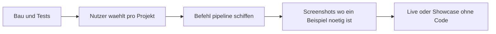

# plan: eigenes autonomes system

Stand: 12. November 2026. Zielprofil: GitHub `Cahja90`. Kein Klarname, Kontakt nur die öffentliche E-Mail.

Es gibt fertige Systeme für einzelne Stationen. Es gibt kein fertiges System, das Profilpflege, privaten SaaS-Code und eine öffentliche Testadresse in einem Lauf verbindet. Wir bauen diese Verbindung selbst. Den Agenten, den PR-Bot und das Hosting bauen wir nicht nach.

## ziel

Ein Auftrag geht von der Aufgabe über Code und GitHub bis zu einer prüfbaren Lieferung.
Der Produktionscode von SaaS bleibt privat. Andere testen das laufende Produkt über eine Live- oder Preview-Adresse.
Die beiden Profil-PDFs sind die Auftragsliste. Was dort als Pflege steht, führt die KI selbst aus.

Der Rechner wird nur soweit benutzt, wie der jeweilige Auftrag es braucht. Produktion, Secrets und Löschen bleiben hinter einer Freigabe.

## bestand: was schon fertig ist

### issue bis pull request, fertige produkte

Diese Produkte schreiben Code, öffnen einen PR und stoppen vor dem Live-Gang.

- [GitHub Copilot coding agent](https://docs.github.com/en/copilot/how-tos/copilot-on-github/use-copilot-agents/kick-off-a-task): Issue zuweisen, eigener Actions-Lauf, Draft-PR, Mensch reviewed. Der PR bleibt Entwurf. Actions des Agenten laufen erst nach „Approve and run workflows“. Copilot merged und deployed nicht. Braucht einen bezahlten Copilot-Plan.
- [Cursor Cloud Agents](https://cursor.com/docs/cloud-agent) und [Automations](https://cursor.com/docs/cloud-agent/automations): eigener Branch, Tests, PR. Start aus Cursor, GitHub, Zeitplan oder Webhook. Das ist der Lauf, den wir schon benutzen.
- [Cursor Apps](https://cursor.com/docs/cloud-agent/apps): aus dem Repo wird eine laufende App mit Datenbank und Anmeldung. Publish prüft Secrets und geht erst live, wenn jemand Publish wählt. Öffentlich teilen geht auf Einzelplänen. Team-Apps bleiben hinter der Cursor-Anmeldung.
- OpenAI Codex auf GitHub: `@codex` reviewed und arbeitet an PRs. Ein Release-Tag ist dort nicht enthalten.

### issue bis github-release, fertig aber andere ziellinie

- [OpenHands Software Factory](https://docs.openhands.dev/openhands/usage/use-cases/software-factory): fertiger Ablauf mit Triage, Entwickler, Reviewer und Watchdog. Der Watchdog merged nur bei grünen Checks. Dafür betreiben wir eine zweite Agenten-Plattform. Ende ist der Merge, nicht die öffentliche Testadresse.
- [Orbi](https://orbi.build/guides/codex-github-issues/): fertig, AGPL, self-hosted oder Orbi Cloud. Label `ai-ready`, Codex schreibt, zweite Session reviewed, nur der freigegebene Stand wird gemerged, danach GitHub Release mit Tag. Orbi liefert das eigene Repo so aus (hundertfach gemerged, Dutzende Releases). Die Ziellinie ist ein Git-Tag, keine Live-URL für Tester, und der Merge läuft unbeaufsichtigt.

### profil, fertige generatoren

- [GitHubAutoProfil](https://github.com/yoanbernabeu/GitHubAutoProfil): eine Action, wöchentlich, README aus öffentlichen Repos, sortiert nach Sternen.
- [easy-github-profile](https://github.com/BerkaySevinc/easy-github-profile): Fork, Repo heißt wie der Username, tägliche SVGs.
- [github-profile-studio](https://github.com/hachiwar/github-profile-studio): größtes fertiges Produkt. Baut README, Pages, Karten, Workflows, Backup und Rollback. Inhalt kommt aus öffentlichen GitHub-Daten plus Formular.
- [Github-Profile-Manager](https://github.com/LoveDoLove/Github-Profile-Manager): Top-Repos nach Sternen plus Beitragsgrafik.

Diese Generatoren pflegen ein Statistik-Profil. Sie kennen die Pin-Reihenfolge aus den Profil-PDFs nicht, und sie stellen private SaaS-Projekte nicht als Demo dar. Ein Stern-Ranking würde `beispiel-pipeline` und `kiwebseiten.net` verlieren, sobald ein anderes öffentliches Repo mehr Sterne hat.

### öffentliche portfolio-seiten, falsche richtung

- [DevPortGen](https://github.com/Imrexxx-OG/DevPortGen), [repo2site](https://github.com/mtafoya-web/repo2site), [Publicolio](https://github.com/nishal21/Publicolio): fertige Seiten aus öffentlichen Repos. Publicolio kann mit einem Token auch private Repos lesen. Das ist das Gegenteil des Modells. Wir veröffentlichen keine Metadaten aus privaten Repos.

### testen ohne quellcode, fertige hoster

- Cloudflare und Vercel: privates Repo, öffentliche URL, eigene Preview pro PR. Das ist der fertige Weg, wie andere das Produkt anfassen, ohne das Repo zu sehen.
- [Nesly](https://nesly.net/docs/git/), [pullpreview](https://github.com/pullpreview/action), [pr-pilot](https://github.com/DevLab-Technologies/PR-Preview): dasselbe als eigene Preview-Produkte. Preview ohne Produktionsdatenbank. Fork-PRs bekommen keine Secrets.
- Showcase-Beispiele, die das Muster nur dokumentieren: [SmartHire](https://github.com/RymarUA/SmartHire-Showcase), [ReviewGo](https://github.com/mert-sayar/reviewgo-showcase), [AODE](https://github.com/Dason222/theaode-case-study). Das sind einzelne READMEs, kein Generator.

### secret-scan, fertig

- [gitleaks-action](https://github.com/gitleaks/gitleaks-action/) und ein lokaler Hook. Pflicht vor Push und noch einmal auf dem PR. [Agent Governance](https://microsoft.github.io/agent-governance-toolkit/tutorials/25-security-hardening/) behandelt das als Deploy-Sperre.

## entscheidung

| station | wir nehmen | wir schreiben |
| --- | --- | --- |
| code und PR | Cursor Cloud Agent, hier | die Auftragsdatei: Ziel, Abnahme, erlaubte Pfade |
| live-URL | Cloudflare auf dem privaten Repo, in der Linie von kiwebseiten.net. Cursor Apps nur für interne Proben | die Freigabe vor Produktion |
| preview für tester | Preview-Deploy des Hosters, leere Daten, keine Produktions-Secrets | die Regel im Repo |
| öffentliches gesicht | nichts fertiges passt | Showcase-README: Problem, Ablauf, Demo-Link, ein Satz dass die Quelle privat ist |
| profil | nichts fertiges passt | markierte Blöcke, Bio, feste Pin-Liste aus den PDFs |
| merge auf main | Mensch | die Checkliste: Tests grün, gitleaks grün, Preview geprüft |
| unbeaufsichtigter merge und release-tag | liegt | Orbi oder OpenHands erst, wenn die Regeln ein Jahr lang halten |

Copilot bleibt die Alternative, falls ein Lauf ganz auf GitHub liegen soll und ein Copilot-Plan da ist. Dann weist der Auftrag das Issue Copilot zu. Merge und Deploy bleiben bei uns.

OpenHands und Orbi installieren wir nicht. Sie wiederholen den PR-Lauf und ziehen den Merge vor die Freigabe.

Profil-Generatoren forken wir nicht. Sie sortieren nach Sternen und überschreiben die kuratierte README.

## aufträge aus den pdfs

Die KI arbeitet diese Liste ab. Die Texte stehen in den PDFs vom 12. November 2026. Ein Auftrag ist eine Datei unter `auftraege/`. Der erste Schreibzugriff auf GitHub wartet auf eine Freigabe. Danach laufen die wiederkehrenden Aufträge selbst, innerhalb der Regeln unten.

### einmal, kapitel 2 und 11

1. `profil_bio`. Setzt am Konto `Cahja90` die Bio `Junior AI Engineer | Autonome Pipelines, RAG, Agenten & MCP | Live-Systeme (kiwebseiten.net)` und die öffentliche E-Mail aus `profil/kontakt.txt`. Kein Klarname, kein Ort, kein LinkedIn. Das Website-Feld ist `https://kiwebseiten.net` als Produktadresse. Fehlt die Kontaktdatei, stoppt der Auftrag.
2. `profil_readme`. Legt das öffentliche Repo `Cahja90/Cahja90` an. Die Überschrift ist `# Cahja90`. Inhalt: Rolle, Projekte, Stack, E-Mail, Produkt-Demos, der Satz dass SaaS-Code privat bleibt. Kein Personenname, kein LinkedIn.
3. `pins_setzen`. Pinnt in dieser Reihenfolge: `beispiel-pipeline`, `beispiel-seite`, `beispiel-anleitung`, `beispiel-saas`, `beispiel-agent`. Ein sechster Pin nur, wenn ein neues öffentliches Showcase existiert.
4. `readme_pins`. Bringt jede gepinnte README auf den Mindeststand aus Kapitel 4.
5. `topics`. Setzt About-Text und Topics. Vorrat: `ai`, `rag`, `agents`, `mcp`, `python`, `llm`, `langchain`, `autonomous`, `pipeline`. Pro Repo nur die Topics, die stimmen.
6. `geheimnisse`. Prüft die öffentlichen Repos mit gitleaks, `.gitignore` und `git status` vor dem Push.

Mindeststand jeder gepinnten README, den Auftrag 4 selbst ergänzt, wenn etwas fehlt:

- ein Satz ganz oben, was das Repo ist
- das Problem
- der Ablauf, als Liste oder Mermaid
- Live-Link oder Screenshot
- ein Satz, was öffentlich ist und was privat bleibt
- eine kurze How-to-run-Anleitung
- Topics

Für `beispiel-seite`, `beispiel-saas` und `beispiel-agent` schreibt die KI den SaaS-Satz aus Kapitel 4: der Produktionscode bleibt privat, das Repo zeigt Architektur, Ablauf und Live-Beweise, der Dienst läuft unter dem genannten Link.

Beispiel-SaaS bleibt zwei Repos. `beispiel-saas-app` ist privat und der einzige Ort für den Code. `beispiel-saas` bleibt öffentlich: README, Lizenz, Bilder und der Demo-Link. Der Agent schreibt Code nur in `beispiel-saas-app`.

Öffentlich darf die KI zeigen: Architektur, Screenshots, Live-Links, Dokumentation, `AGENTS.md`, kleine Beispiele, gelernte Entscheidungen.
Privat bleibt: Keys, voller Quellcode kostenpflichtiger Dienste, Kundendaten, interne Prompts, die das Produkt ausmachen.

### wiederkehrend, kapitel 7 und 11

Die KI startet diese Läufe selbst. Ein Commit entsteht nur, wenn eine Datei sich wirklich ändert.

- `pflege_tag`. Sucht einen sinnvollen Punkt: tote Demo, veralteten Satz, fehlendes Topic, Screenshot-Hinweis, kleinen Fix. Findet sie nichts, schreibt sie „nichts zu tun“ ins Log und committet nicht.
- `pflege_pin`, zwei- bis dreimal die Woche. Öffnet ein gepinntes Repo, ruft den Demo-Link ab, zieht README, Beschreibung und Topics nach.
- `pflege_woche`. Aktualisiert in der Profil-README den Block zum aktuellen Projekt oder Learning. Pflegt ein Repo tiefer: Architektur, Mermaid, „was ich gelernt habe“. Prüft, ob die Pins noch der Liste entsprechen.
- `pflege_monat`. Legt nur dann ein kleines öffentliches Showcase an, wenn die Auswahl das Projekt auf `hoch` oder `ohne_code` setzt. Holt Profilaufrufe und Stars und legt eine kurze Notiz ab. Kein LinkedIn-Text.

### bewerbung, kapitel 10

`bewerbung_text` hält einen kurzen Block aktuell: GitHub-Link, ein bis zwei Projekte (`beispiel-pipeline`, `kiwebseiten.net`), der Satz dass Live-Systeme laufen und SaaS-Code privat bleibt, plus der Hinweis auf praktische Agenten- und RAG-Arbeit. Kontakt im Text ist nur die E-Mail. Kein Klarname. Die KI speichert den Text im Profil-Repo. Verschicken bleibt außerhalb dieses Laufs.

### sicherheit, kapitel 6, vor jedem push

Die KI macht das selbst, bevor sie pusht:

- `git status` und `git diff` lesen
- gitleaks auf die Änderung, danach noch einmal auf dem PR
- `.env` steht in `.gitignore`
- keine Kundendaten, keine Keys, in Screenshots keine Mails und keine Token-URLs
- Demo-Schlüssel und Produktions-Schlüssel bleiben getrennt
- bei einem Fund: nicht pushen, Lauf stoppen, im Bericht die nächsten Schritte nennen: Token widerrufen, betroffenes Repo auf privat stellen, GitHub Support informieren

Ein echtes Profilfoto aufnehmen kann die KI nicht. Sie meldet, wenn der Standard-Avatar noch steht.

## pipeline

Nach dem Bau entscheidet die KI nicht, was hochgeht. Sie schreibt `auftraege/auswahl.yaml` mit einem Eintrag pro gebautem Projekt. Der Nutzer setzt dort drei Werte:

- `hoch`: das Projekt geht live
- `ohne_code`: es wird öffentlich gezeigt, der Produktionscode bleibt privat
- `zu`: es geht nicht hoch

Erst der Befehl `pipeline schiffen` führt den Rest autonom aus. Die Pipeline fragt in diesem Lauf nicht wieder.



1. Der Bau läuft auf Befehl: Cursor auf einem Branch, Tests und gitleaks. Rot stoppt vor der Auswahl.
2. Die Preview hängt nicht an der Produktionsdatenbank. Sie ist nur die Vorlage für die Entscheidung und für Bilder.
3. Fehlt bei einem Projekt mit `hoch` oder `ohne_code` ein Beispiel, macht die Pipeline Screenshots von der Preview und legt sie ins öffentliche Repo. Auf den Bildern sind keine Keys, Mails oder Token-URLs.
4. `hoch` deployed auf Cloudflare und schreibt Demo-Link plus Bilder in die öffentliche README.
5. `ohne_code` pusht keinen Produktionscode. Öffentlich werden Ablauf, Demo-Link, Beispielbilder und der Satz, dass die Quelle privat bleibt.
6. `zu` lässt die Pipeline liegen. Bezahlung, Löschen und Force-Push bleiben außerhalb dieses Befehls.

Forks von Fremden laufen nie mit unseren Secrets.

## zwei repos pro saas

| repo | sichtbarkeit | inhalt |
| --- | --- | --- |
| produkt | privat | Quellcode, Tests, Deploy. Secrets bleiben außerhalb von Git |
| showcase | öffentlich | Problem, Ablauf, Architektur, Demo-Link, How-to-try, Topics |

Öffentliche Pins für `Cahja90`, fest, nicht nach Sternen:

1. beispiel-pipeline
2. beispiel-seite / kiwebseiten.net
3. beispiel-anleitung
4. beispiel-saas
5. beispiel-agent

Profil-README im Repo `Cahja90/Cahja90`. Überschrift ist `Cahja90`. Bio und öffentliche E-Mail setzt Auftrag `profil_bio`. Kein Klarname, kein Ort, kein LinkedIn. Spätere Läufe ändern nur die markierten Blöcke und committen nur bei einer echten Änderung.

## eigener code

Im Hub-Ordner. Klein. Kein zweiter Agent.

```text
auftraege/          eine yaml pro pdf-auftrag, dazu auswahl.yaml
pipeline/           bau, auswahl lesen, screenshots, schiffen
regeln/             öffentlich gegen privat, pin-liste, geheimnisse
profil/             bio, readme-text, bewerbungsblock, kontakt.txt
showcase/           mindeststand der öffentlichen readme
```

Namen: Dateien und Funktionen klein mit Unterstrich, Klassen mit großem Anfang, Konstanten in Großbuchstaben.
Kommentare im Code klein, ohne Leerzeichen nach `#`.

## stufen

1. Die Pipeline bauen: Bau, `auswahl.yaml`, Befehl `pipeline schiffen`, Screenshot-Schritt, Zweig `hoch` und Zweig `ohne_code`.
2. Die Auftragsdateien aus der PDF-Liste anlegen: die sechs Einmal-Aufträge und die vier Pflege-Aufträge. Noch kein Schreibzugriff.
3. Einmal-Lauf der KI: Bio, E-Mail, Profil-README, Pins, README-Mindeststand, Topics, Geheimnisse. Der erste Push wartet auf eine Freigabe. Danach pflegt die KI diese Punkte selbst.
4. Zeitplan an `pflege_tag`, `pflege_pin`, `pflege_woche`, `pflege_monat`. Hochgehen hängt nicht an diesem Zeitplan, sondern an der Auswahl und am Befehl.
5. Ein Bau eines Beispiels, dann Auswahl durch den Nutzer, dann ein autonomer Lauf von `pipeline schiffen`.

## regeln, die jeder lauf einhält

- Secrets liegen außerhalb von Git. `.env` steht in `.gitignore`.
- gitleaks auf die Änderung vor dem Push und noch einmal auf dem PR.
- Preview ohne Produktionsdatenbank und ohne Produktions-Secrets.
- Issue-Text ändert keine Gates.
- Screenshots ohne Keys, Mails und Token-URLs.
- Ein Commit nur, wenn sich die Datei geändert hat.
